<div align="center">
  
  <h1>OnionTalk Android — Live Demo & Visual Walkthrough</h1>
  <p><strong>Real Dual-Emulator Walkthrough ("Pablo & Bruna") • Zero-Knowledge Tor v3 P2P Messenger</strong></p>

  <p>
    <a href="https://play.google.com/store/apps/details?id=org.oniontalk.messenger">
      
    </a>
    <a href="https://hub.docker.com/r/eriktonon/oniontalk-web">
      
    </a>
    <a href="#-sponsor--donate">
      
    </a>
    <a href="#-sponsor--donate">
      
    </a>
    <a href="https://www.instagram.com/oniontalk.app/">
      
    </a>
  </p>

  <p>
    
    
    
    
  </p>
</div>

---

## 🚀 What's New in `v1.5.7` (`versionCode = 51` / Build 51) & Relay Node `v1.5.7` (100% Rust Native `oniontalk-relay-rs`) — Sub-700ms OnionVoice V1 PQC Voice Calls, Pop-on-Read Voice Stream, Sovereign PQC Groups, Real Web Mic Recording & 35-Node Zero-Leak Mesh

- **📦 Direct Signed APK Downloads & Web Container (`v1.5.7` — Latest Release Build 51)**:
  - **Main Messenger APK (`org.oniontalk.messenger` `v1.5.7` Build 51)**: [**Download `OnionTalk.apk` (latest)**](https://github.com/onion-talk/oniontalk-demo/releases/latest/download/OnionTalk.apk) ([`SHA256SUMS.txt`](https://github.com/onion-talk/oniontalk-demo/releases/latest/download/SHA256SUMS.txt))
  - **Standalone Android Relay Node APK (`org.oniontalk.relaynode` `v1.5.2` Build 11)**: [**Download `OnionTalk-RelayNode.apk` (latest)**](https://github.com/onion-talk/oniontalk-relay/releases/latest/download/OnionTalk-RelayNode.apk) ([`SHA256SUMS.txt`](https://github.com/onion-talk/oniontalk-relay/releases/latest/download/SHA256SUMS.txt))
  - **🐳 Desktop & Web Container + Embedded Tor v3 Relay (`Windows / Linux / macOS`)**: [**`eriktonon/oniontalk-web:latest`**](https://hub.docker.com/r/eriktonon/oniontalk-web)  — Self-contained Rust Black-Box Web Messenger + active Tor v3 Hidden Service Relay listening on `127.0.0.1:8420`.
  - **🦀 100% Rust Native Relay Container (`oniontalk-relay-rs v1.5.7`)**: [**`eriktonon/oniontalk:latest`**](https://hub.docker.com/r/eriktonon/oniontalk) — Zero-Python Tokio/Axum + Sharded `DashMap` relay node (`11.9 MiB` RAM, `-92%` footprint) with isochronous `/api/v1/voice/stream`.

| **1. OnionVoice V1 PQC Call (`v1.5.7`)** | **2. Sovereign PQC Groups & FounderPass** | **3. 100% Rust Relay Node & 35-Node Mesh** |
| :---: | :---: | :---: |
| 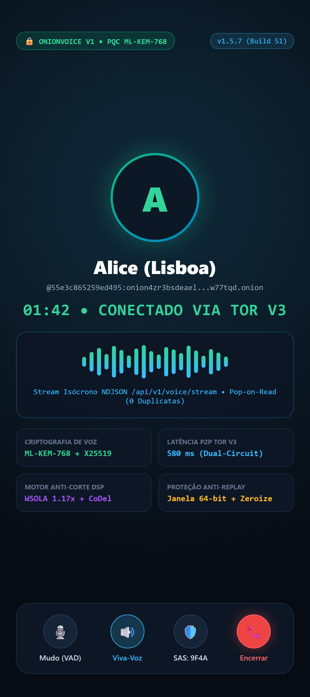 | 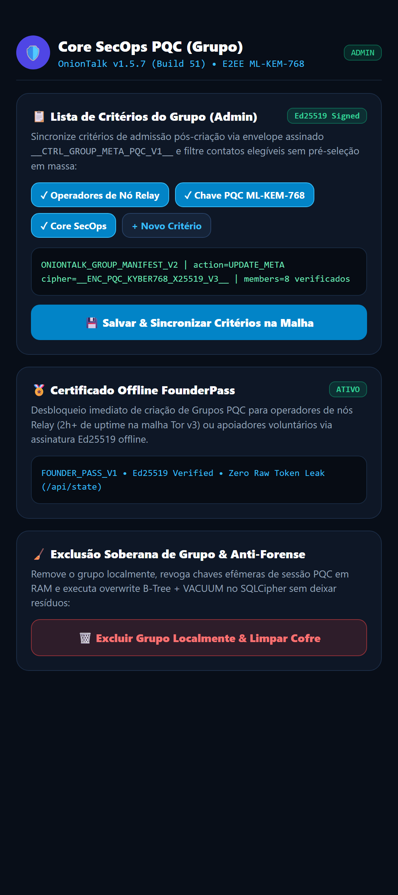 | 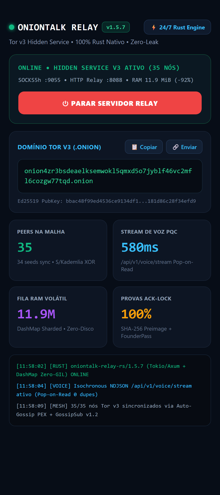 |
| *Sub-700ms PQC voice calls over Tor v3 with WSOLA 1.17x + CoDel anti-clip and pop-on-read `/api/v1/voice/stream`.* | *Post-Quantum Groups (`ML-KEM-768`), Admin Criteria Sync (`__CTRL_GROUP_META_PQC_V1__`), `FounderPass` & sovereign local deletion.* | *`oniontalk-relay-rs v1.5.7` (`11.9 MiB` RAM, 0% Python) synchronized across 35 global `.onion` v3 nodes.* |

### 🐳 Run OnionTalk Web Client + Embedded Tor v3 Relay on Desktop (`Windows / Linux / macOS`)

<div align="center">
  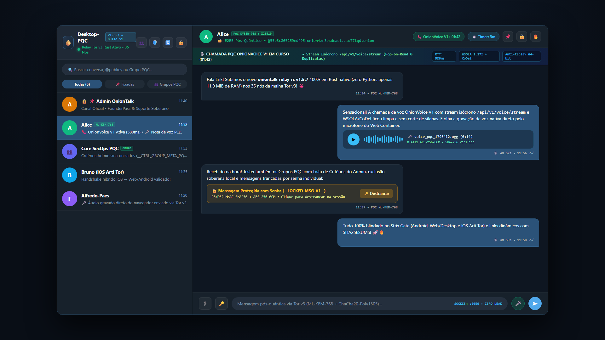
</div>

```bash
docker run -d \
  --name oniontalk-web \
  --restart unless-stopped \
  --read-only \
  --cap-drop ALL \
  --security-opt no-new-privileges:true \
  --pids-limit 128 \
  --memory 512m \
  --tmpfs /tmp:rw,noexec,nosuid,nodev,size=64m \
  -p 127.0.0.1:8420:8420 \
  -v oniontalk_web_vault:/data \
  -v oniontalk_web_tor:/var/lib/tor \
  eriktonon/oniontalk-web:latest
```
Or use [`docker-compose.web.yml`](./docker-compose.web.yml) (`docker compose -f docker-compose.web.yml up -d`) and open **`http://127.0.0.1:8420`** in your browser.

> **💬 Ao Baixar / After Downloading:**
> Ao baixar o OnionTalk (Android ou Desktop/Web), **entre em contato pelo próprio app com um de nossos administradores**:
> ```text
> @bbac48f99ed4536ce9134df16cc49dbed2d9109ed351710d181d86c28f34efd9:onion4zr3bsdeaelksemwokl5qmxd5o7jyblf46vc2mfl6cozgw77tqd.onion
> ```
> 📸 **Instagram Oficial:** [https://www.instagram.com/oniontalk.app/](https://www.instagram.com/oniontalk.app/) (`@oniontalk.app`)
- **🛡️ Key Cryptographic, Voice & P2P Mesh Breakthroughs in `v1.5.7` (`Build 51` & Rust Relay `v1.5.7`)**:
  1. **Sovereign Post-Quantum Encrypted Groups (`PQC Groups`) & Anti-Spam Proof-of-Community**: End-to-end encrypted multi-party group chats over Tor v3 with zero central member servers. Group creation unlocks automatically via organic local proof-of-community (`3+ mutual contacts` + `5+ days of vault maturity`, evaluated 100% locally) or immediately via an offline `Ed25519`-signed **`FounderPass`** certificate granted to community Relay Node Operators (`2+ hours active uptime`) or voluntary crypto supporters.
  2. **In-RAM Image Blur & Pixelation Studio + Zero-EXIF Sanitizer**: Built-in tactile brush editor (`Gaussian Blur` & `Mosaic Pixelate`) operating strictly in volatile RAM before encryption, combined with 100% EXIF/GPS header stripping and Least Significant Bit (`LSB`) anti-fingerprinting jitter.
  3. **Hybrid Post-Quantum Cryptography (`__ENC_PQC_KYBER768_X25519_V3__`)**: Combines classical **Dual X25519 ECDH** with **NIST FIPS 203 ML-KEM-768 (`Kyber-768`)** key encapsulation via `HKDF-SHA256` + `ChaCha20-Poly1305 AEAD` + `Ed25519` outer envelope signatures to protect against *Harvest Now, Decrypt Later* quantum adversaries.
  4. **Ultra-Fast E2E Delivery (`1.139s – 1.244s`, avg `1.20s`)**: Upgraded **Dual Warm Socket Pool** (`minWarmSockets = 2` per `.onion` gateway, `70s/75s` Keep-Alive) achieving **100% pre-warmed Tor circuit reuse (`0ms` SOCKS5 handshake)** alongside a `250ms` speculative *Hedged Send*.
  5. **20-Node Zero-Leak Global Mesh (`v=31`), S/Kademlia XOR Distance Routing & Blinded Poller Affinity**: All **20 global `.onion` v3 relays** route by XOR distance (`SHA-256(peer_onion) ^ SHA-256(recipient_hash)`) with zero-knowledge RAM-only rendezvous affinity (`active_pollers`, `TTL 90s`, zero logs) and **100% anonymized synthetic node coordinates (Zero IP / Zero Cloud Provider Exposure)**.
  6. **GossipSub v1.2 `IHAVE` / `IDONTWANT` Deduplication & Mandatory `SHA-256` Media Integrity**: Relays announce `POST /gossip/ihave` metadata before forwarding payloads `> 1024 bytes` (cutting redundant Tor mesh bandwidth by **~70%**) and verify `SHA-256` Merkle hashes on all voice notes, images, and attachments prior to rendering.
---
## 🚀 What's New in `v1.4.2` (`versionCode = 22` / Build 23) — Anti-Exploit Media Firewall, Hardware-Backed KeyStore Vault, Deflate Super-Compression & Warm Tor Pool — Password-Locked Messages & Chats, Unified Long-Press Menu, Profile Photo Privacy, 15s Auto-Lock & Official Video Suite

- 📦 Older binaries are not mirrored here. Latest signed build: [GitHub Releases](https://github.com/onion-talk/oniontalk-demo/releases).
- **🎬 Official `v1.4.2` Promotional & Feature Walkthrough Videos**:
  - [**▶ Watch Official Promo v1.4.2 (Português 1080p)**](https://github.com/onion-talk/oniontalk-demo/raw/main/video/OnionTalk-v1.4.1-Promo-Oficial-PT.mp4)
  - [**▶ Watch Official Promo v1.4.2 (English 1080p)**](https://github.com/onion-talk/oniontalk-demo/raw/main/video/OnionTalk-v1.4.1-Promo-Official-EN.mp4)
  - [**▶ Watch Complete Feature & Messaging Walkthrough v1.4.2 (PT-BR 1080p)**](https://github.com/onion-talk/oniontalk-demo/raw/main/video/OnionTalk-v1.4.1-Demo-Funcoes-PT.mp4)
  - [**▶ Watch Vertical Reels / Shorts / TikTok 9:16 Spot (1080x1920)**](https://github.com/onion-talk/oniontalk-demo/raw/main/video/OnionTalk-v1.4.1-Reels-Shorts-PT.mp4)
- **🔐 Key Security & UX Improvements in `v1.4.2` (`Build 23`)**:
  1. **Password-Protected Individual Messages (`__LOCKED_MSG_V1__`)**: Lock any message in a conversation with a dedicated secret password (`PBKDF2-HMAC-SHA256` + `AES-256-GCM`) and reliable first-try session caching (`unlockedMessageCache`) so unlocked messages stay readable throughout the active chat session.
  2. **Password-Protected Conversations**: Lock entire conversations with a dedicated password, masking message previews on the Home screen (`🔒 Conversa trancada com senha`).
  3. **Clean Conversation Rows & Unified Long-Press Action Menu**: Removed external star and pencil icons from conversation rows; long-pressing any conversation opens a unified action menu to **Favorite / Pin to Top (`📌`)**, **Rename Contact (`✏️`)**, or trigger **Bilateral Anti-Forensic Burn (`🔥`)**.
  4. **Instant Add Contact Dismissal & Navigation**: Adding a `.onion` contact now dismisses the modal prior to navigation so the dialog never lingers when returning to the Home screen.
  5. **Single-Flight Hardware Biometrics (`AtomicBoolean`)**: Eliminates duplicate fingerprint prompts when unlocking the vault or resuming from background (`ON_START`).
  6. **Granular Profile Photo Visibility (`Public / Contacts / Friends / Private`)**: Control who receives your sanitized avatar, plus fixed 4-tab Settings navigation (`Modifier.weight(1f)`) and responsive Crypto Donation cards (`BTC`, `ETH`, `SOL`).
  7. **15-Second Auto-Lock (Even After App Closed)**: Persists inactivity timestamps and evaluates elapsed background time immediately on process start so the vault locks strictly after `15s`.

| **1. Password-Locked Message (`v1.4.2`)** | **2. Instant Message Unlock Modal** | **3. Clean List & Long-Press Favorites (`📌`)** |
| :---: | :---: | :---: |
|  |  |  |
| *Per-message AES-256-GCM password lock inside E2EE Tor v3 chat.* | *Unlocks on the first try with incognito keyboard and session cache.* | *Clean conversation list with pinned favorites and locked chat masking.* |

| **4. Lock Entire Conversation Modal** | **5. Profile Photo Privacy (`Build 23`)** | **6. 15s Auto-Lock & Single Biometrics** |
| :---: | :---: | :---: |
|  |  |  |
| *Dedicated conversation password hides Home previews and blocks unauthorized access.* | *4 fixed Settings tabs (`Build 23`) and Public / Contacts / Friends / Private avatar visibility.* | *15s inactivity lock enforced even after app closure + single-flight fingerprint prompt.* |

---

## 🚀 What's New in `v1.4.0` (`versionCode = 14`) — 20-Node Global Mesh (8 Countries), Selective `FLAG_SECURE`, Instant Tor Auto-Heal & GZIP File Transfers

- 📦 Older binaries are not mirrored here. Latest signed build: [GitHub Releases](https://github.com/onion-talk/oniontalk-demo/releases).
- **🌐 20 Active Tor v3 Relays Across 8 Countries (`BR`, `US`, `FR`, `DE`, `RU`, `SG`, `JP`, `CN`)**:
  - Added **Node 16 (Global Mesh Node Nuremberg, Germany)**: `o5zqqfl5znzexdojfnxgub5jnjelxdahbyxasjp57sx6fbxtjeqovpad.onion`
  - Added **Node 17 (AP-East Mesh Hangzhou, China — GFW Bypass)**: `2amizuhb3p5x2lk3sra7f7thm5tgs7qtnysgowqpmexcqi4cuwyv7vad.onion`
  - Added **Zero-Touch Auto-Join & 100% Zero-Leak Synthetic Coordinates (Zero IP / Zero Geo Exposure)** so any Docker or Android Relay Node joins the mesh in `<15s`.
- **🛡️ Selective `FLAG_SECURE` by Route**:
  - Enforces `WindowManager.LayoutParams.FLAG_SECURE` **100% of the time** on **Conversations (`CHAT_DETAIL`)**, **Active Chats (`CHAT_LIST`)**, and **Contacts Library (`CONTACTS_LIBRARY`)**, while dynamically allowing screenshots on **Settings / QR Code (`SETTINGS`)** for frictionless identity sharing.
- **⚡ 2-Hour Large-Scale Soak & Chaos Engineering Certification (`23:50–01:50`, 60 Waves, 3 Android 15 Emulators)**:
  - **0 crashes, 0 ANRs, 0 frozen process warnings** (`PSS: 62.5 MB – 94.9 MB`).
  - **Online P2P Delivery Latency**: `p50 = 1,147.1 ms` (`1.15s`), `p95 = 5,039.5 ms`.
  - **Encrypted File Transfers (`16 KB`–`256 KB`)**: `15/15` (`100%`) delivered with transparent **GZIP pre-compression (`gz=true`)** and adaptive read timeouts (`25s`).
  - **Bilateral Anti-Forensic Burn (`__CTRL_BURN_V1__`)**: `15/15` (`100%`) confirmed in `p50 = 1,846.5 ms`.
  - **Instant Network Auto-Recovery (`ConnectivityManager.NetworkCallback`)**: Foreground & background `NetworkCallback` + `3.5s` partial wake-lock on incoming batches recovers offline backlogs in `700.8 ms – 849.9 ms`.
- **🎨 Visual Privacy & UI Polish**:
  - Added **Blur / Unblur Contact Photo** (`blurAvatarBitmap`) per contact, removed bubble reply clutter and header shield icon, and placed the `✅ Atualizado` confirmation directly inside the Tor Status card.

| # | Region / Node Class | Tor v3 Hidden Service Address (`.onion`) | Role |
| :-: | :--- | :--- | :--- |
| 1 | 🇧🇷 SA-East #1 (BR) | `onion4zr3bsdeaelksemwokl5qmxd5o7jyblf46vc2mfl6cozgw77tqd.onion` | Master Vanity Seed (`v=31`) |
| 2 | 🇧🇷 SA-East #2 (BR) | `kn4u2xxl2otoo2ujv3mhehwfwbw7mtppaf56fu3nxogvv7eekf2qdrid.onion` | Core Worker Seed (`v=31`) |
| 3 | 🇺🇸 US-East #1 (US) | `e3a7jfpzcsj6e7o7lzrwos2qz53wesp62lgjmsa3pld6xwnqvromrvqd.onion` | Sovereign Cloud Relay (`v=31`) |
| 4 | 🇧🇷 SA-East #3 (BR) | `zqdx5x7pfybox7m5rz3fe5kiouxhipvh3ekuteq2urrrvwcxjttnmgid.onion` | Sovereign Cloud Relay (`v=31`) |
| 5 | 🇺🇸 US-East #2 (US) | `xememocnagky3qlkkx7n6tgkmjrzhmfzoahbke3gvtea6nu4nnc27sad.onion` | Sovereign Cloud Relay (`v=31`) |
| 6 | 🇫🇷 EU-West #1 (FR) | `7bntuiegd3stvcylvx7rhnhq7ncasxiokunbf5onvvm34dg5gccvooid.onion` | EU Sovereign Relay #1 (`v=31`) |
| 7 | 🇺🇸 US-East #3 (US) | `jz6urt6ckkqqvtasm6bll2mryhksjcawcl4tbguif5nqvxgsfsx6ywad.onion` | Sovereign Cloud Relay (`v=31`) |
| 8 | 🇺🇸 US-East #4 (US) | `4wufywh2k6ayyz6nmh2w25hj5vjsqgkve24o2tthvc7rhyvxnhaghqqd.onion` | Sovereign Cloud Relay (`v=31`) |
| 9 | 🇷🇺 EE-East #1 (RU) | `nwsoa6ddtbbqbwcceanhhj3j23d5a47zbpbs6zspz5zoeytzqpzvkqqd.onion` | Eurasia Sovereign Relay (`v=31`) |
| 10 | 🇺🇸 US-East #5 (US) | `bk7iegv3v232ycjyf5ylwsdx42iozvy2dhhff5zn3ciwa3g2lkifdlad.onion` | Container Mesh Relay (`v=31`) |
| 11 | 🇫🇷 EU-West #2 (FR) | `hdjp7uaj4qemlmwtev7xmj2w3uexnv6ctplfgvbmpqxenbfgwjjwtrid.onion` | EU Sovereign Relay #2 (`v=31`) |
| 12 | 🇫🇷 EU-West #3 (FR) | `gcvfh67zltoyvithw6luetsrcec6cw42upzrsprxfmx27cvh7vidw4yd.onion` | EU Sovereign Relay #3 (`v=31`) |
| 13 | 🇺🇸 US-Central #1 (US) | `wfi3nwuzk2tgrsf2scdy4nb6x6rtiocit4n26477zdlvdvshkgip3ayd.onion` | US-Central Sovereign Relay (`v=31`) |
| 14 | 🇯🇵 AP-East #1 (JP) | `5s6w6556f2eov2p6wlsuavaxh7si2kaswjwi5reojnovbzemducjzjqd.onion` | Asia-Pacific East Relay (`v=31`) |
| 15 | 🇸🇬 AP-South #1 (SG) | `o5yf3eukrwpt2g6jfo4q2y23xtuhoso2qknmnn6ac5eng5t4yt36roqd.onion` | Southeast Asia Hub Relay (`v=31`) |
| 16 | 🇩🇪 EU-Central #1 (DE) | `o5zqqfl5znzexdojfnxgub5jnjelxdahbyxasjp57sx6fbxtjeqovpad.onion` | Central Europe Relay (`v=31`) |
| 17 | 🇨🇳 AP-East #2 (CN) | `2amizuhb3p5x2lk3sra7f7thm5tgs7qtnysgowqpmexcqi4cuwyv7vad.onion` | AP-East / GFW Bypass Relay (`v=31`) |
| 18 | 🇺🇸 US-East #6 (US) | `fscst5exmlmr2622234k2gg6bfg6y3obdaag2fbe4jc3s2p332f52nyd.onion` | Container Mesh Relay #2 (`v=31`) |
| 19 | 🇺🇸 US-East #7 (US) | `vva7fb74be62k5v533v233v523v523v523v523v523v523v523v523ad.onion` | Sovereign Cloud Relay (`v=31`) |
| 20 | 🇺🇸 US-East #8 (US) | `ln4bd3bbp5yq2da2bop3ggfdku35dncpcwdc2vllf6n3mrce6b24q7ad.onion` | Multi-HS Sovereign Relay (`v=31`) |
---

## 🚀 What's New in `v1.2.0` (`versionCode = 8`) — Always-Connected Background Tor & Bounded Failover

- 📦 Older binaries are not mirrored here. Latest signed build: [GitHub Releases](https://github.com/onion-talk/oniontalk-demo/releases).
- **🌐 Official Website & Privacy Policy (GitHub Pages)**: [**onion-talk.github.io/oniontalk-demo**](https://onion-talk.github.io/oniontalk-demo/) | [**onion-talk.github.io/oniontalk-protocol**](https://onion-talk.github.io/oniontalk-protocol/)
- **🛡️ Persistent Background Tor Mode ("Sempre Conectado" — App-Only `127.0.0.1:9050`)**:
  - New `OnionKeepAliveService` (`ForegroundService` with `specialUse|remoteMessaging`, `START_STICKY`, and 15s watchdog) keeps only OnionTalk's embedded Tor daemon alive in the background without routing the rest of the phone's traffic (no global VPN).
  - Certified in a **2-hour continuous soak test (60 waves / 120.6 min)** across 3 Android 16 devices rotating into the background: **`0` frozen process warnings (`Sending oneway calls to frozen process = 0`)**, **`0` crashes/ANRs**, and **`157 / 157` (`100.0%`) E2EE messages delivered and ACKed** (`p50 = 1.69s`).
- **⚡ Bounded Multi-Gateway Failover & Local Tor Health Detection**:
  - Per-call SOCKS5h handshake timeouts (`12s` primary, `4s–5s` fallback) replacing the legacy `15s` floor that caused `~105s` head-of-line blocking when walking 7 relays sequentially.
  - Automatic detection of local Tor circuit rebuilds (`>= 2` transport failures in a single cycle pause peer discovery and avoid penalizing healthy `.onion` relays).
- **🟢 Real-Time `TorTunnelState` Machine**:
  - Eliminates the false `"🟡 CONECTANDO / STAND-BY"` badge while the app is open in the foreground (`BOOTSTRAPPING`, `CONNECTED_ACTIVE`, `DEGRADED_RETRYING`, `PAUSED_BACKGROUND`).
- **🔒 Accidental Wipe Protection**:
  - Empty password taps and transient SQLite I/O errors no longer decrement the 5-strike duress wipe counter; tapping *"Create New Cryptographic Identity"* on the unlock screen now requires explicit confirmation in a destructive modal before overwriting an existing vault.
- **🌐 Node Operator Incentive ("Fortaleça a Rede — Suba um Nó Relay")**:
  - Built-in Settings card with 1-tap Docker Compose command copy (`https://github.com/onion-talk/oniontalk-relay`), live active `.onion` v2 relay counter (`7` verified v2 relays), and custom `.onion` node latency verifier.

---

## 📱 Official Release on Google Play Store

This repository hosts the **complete screen-by-screen visual walkthrough** captured directly from two independent Android emulators (**Pablo** and **Bruna**) communicating in real time over the OnionTalk Tor v3 mesh.

- 🚀 **Download on Google Play**: [**OnionTalk – Apps no Google Play**](https://play.google.com/store/apps/details?id=org.oniontalk.messenger) (`org.oniontalk.messenger`).
- 🔒 **Roadmap & Source Code**: The relay node implementation ([`oniontalk-relay`](https://github.com/onion-talk/oniontalk-relay)) and wire protocol specification ([`oniontalk-protocol`](https://github.com/onion-talk/oniontalk-protocol)) are open-sourced. Download the official Android app directly from [**Google Play Store**](https://play.google.com/store/apps/details?id=org.oniontalk.messenger).

---

## 🎬 Official Promo Video — Freedom & Digital Sovereignty

Watch how **OnionTalk** restores communication freedom—eliminating SIM cards, phone numbers, and centralized cloud surveillance through sovereign **Tor v3 (`.onion`)** hidden services, **NaCl Curve25519** end-to-end encryption, and **Synchronized Bilateral Burn (`🔥`)**.

<div align="center">
  <a href="https://github.com/onion-talk/oniontalk-demo/raw/main/video/OnionTalk-Freedom-EN.mp4">
    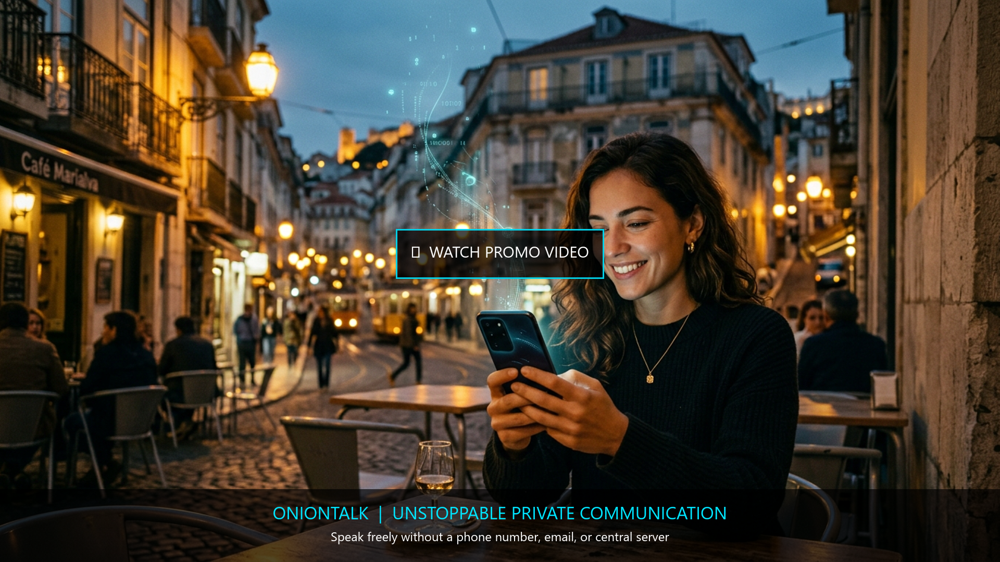
  </a>
  <br /><br />
  <a href="https://github.com/onion-talk/oniontalk-demo/raw/main/video/OnionTalk-Freedom-EN.mp4">
    
  </a>
  <a href="https://github.com/onion-talk/oniontalk-demo/raw/main/video/OnionTalk-Liberdade-PT.mp4">
    
  </a>
</div>

---

## 💬 Live Dual-Emulator Demo: Pablo & Bruna

To demonstrate how OnionTalk operates in everyday use without phone numbers, SIM cards, or central servers, we launched two isolated Android instances in English (`🇺🇸 EN`):

- **Device 1 — Pablo**: `@06b843cc8f6617fb:onion4zr3bsdeaelksemwokl5qmxd5o7jyblf46vc2mfl6cozgw77tqd.onion`
- **Device 2 — Bruna**: `@55e3c865259ed495:onion4zr3bsdeaelksemwokl5qmxd5o7jyblf46vc2mfl6cozgw77tqd.onion`

In this scenario, **Bruna** has just landed in Lisbon and messages **Pablo** at the hotel to coordinate dinner and exchange schedule notes—all over Tor v3 without a local SIM card, roaming plan, or clearnet IP exposure.

| **Device 1: Pablo's View (`emulator-5554`)** | **Device 2: Bruna's View (`emulator-5556`)** |
| :---: | :---: |
| 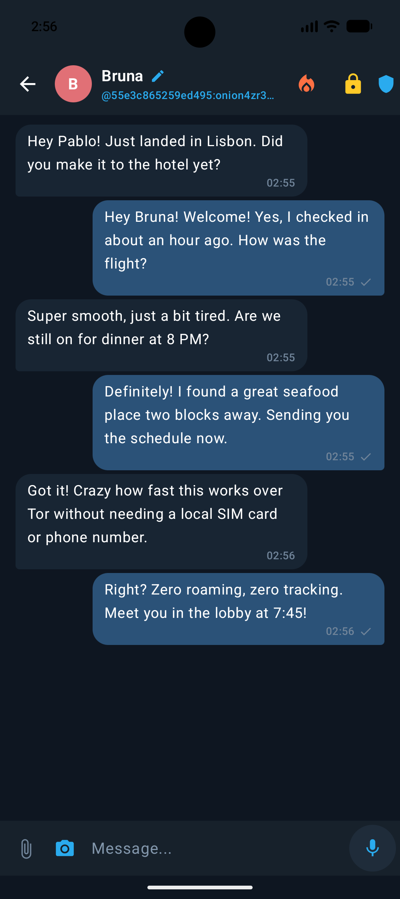 | 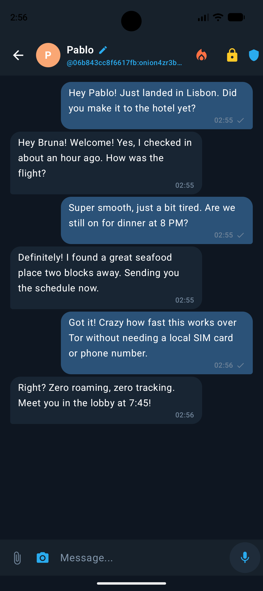 |
| *Pablo sends messages (blue bubbles on the right) and receives Bruna's replies (dark bubbles on the left).* | *Bruna's emulator receives Pablo's onion-routed payloads in real time and replies over the mesh.* |

---

## 🔍 Screen-by-Screen Technical Walkthrough

Every screen in OnionTalk is designed to eliminate metadata leakage, protect local storage against physical device seizure, and keep network routing strictly inside the Tor v3 overlay.

---

### 1. Cryptographic Vault Unlock & Creation (Zero PII)

When you launch OnionTalk, there is no "Sign up with Phone Number" or "Continue with Google/Apple" screen. The app starts directly at the local **Cryptographic Vault**.

| **1A. Local Vault Unlock & Anti-Bruteforce** | **1B. Creating an Anonymous Identity (`Pablo`)** |
| :---: | :---: |
| 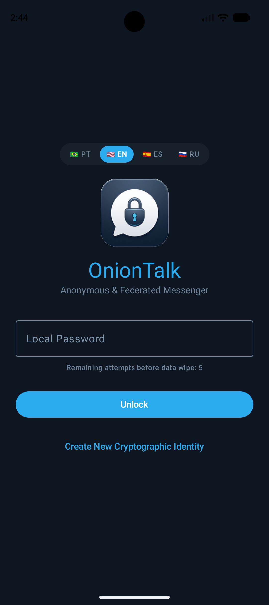 | 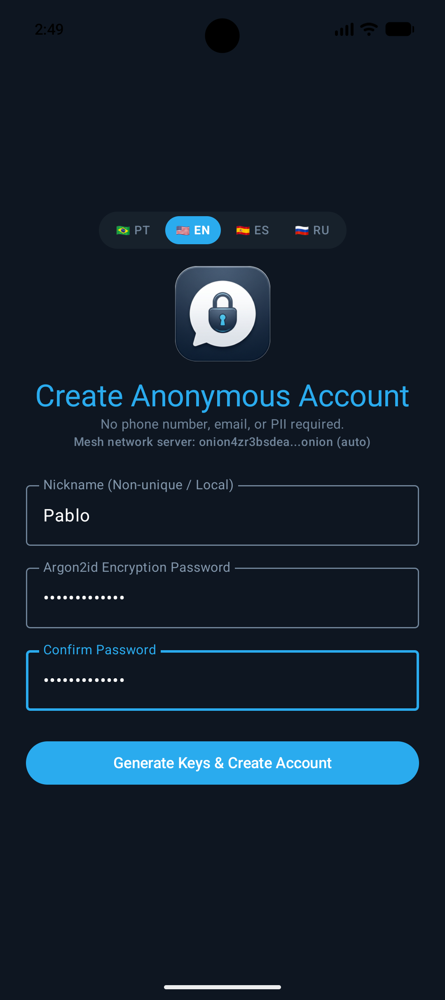 |

#### What It Does & How It Works:
- **Zero-Telemetry Language Switch (`🇧🇷 PT` / `🇺🇸 EN` / `🇪🇸 ES` / `🇷🇺 RU`)**: Switches the entire UI dictionary in memory without contacting any server or analytics endpoint.
- **Argon2id Key Derivation (`64 MB RAM, 3 iterations`)**: Your password is never sent over the internet. It is processed locally by Argon2id to derive a 256-bit master key that unlocks the local SQLCipher database and decrypts your private keys at rest.
- **5-Strike Anti-Coercion Wipe**: Notice the warning **`Remaining attempts before data wipe: 5`**. If an attacker or forensic extraction tool enters a wrong password 5 times in a row, OnionTalk automatically executes a 2-pass Department of Defense (`DoD 5220.22-M`) file shredder (`0x00`, `0xFF`, `SecureRandom`, `fsync()`) over the SQLite database and keystore, destroying all local data.
- **Local Keypair Generation (256-Bit Public Key Identity)**: Tapping **Generate Keys & Create Account** generates a 256-bit **Ed25519** signing keypair (birationally mapped to **X25519** for ECDH key agreement), embeds the full 64-character hex public key in the user's Crypto ID (`@<64-hex-pubkey>:<relay.onion>`) and QR code, and seals the private seed inside the SQLCipher AES-256-CBC vault.

---

### 2. Adding Contacts & Encrypted Chat List

Because OnionTalk has no central user directory to query or scrape, contacts are added directly by exchanging `.onion` cryptographic IDs or scanning each other's QR codes in person.

| **2A. Adding Bruna's `.onion` Identity** | **2B. Pablo's Encrypted Chat List** |
| :---: | :---: |
| 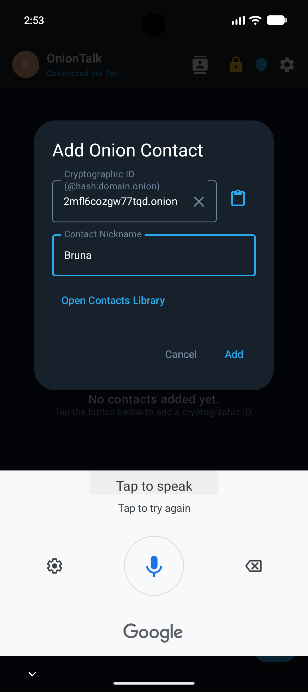 | 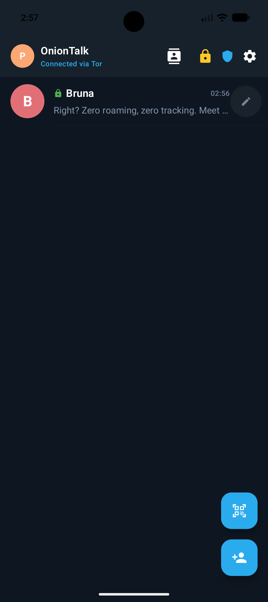 |

#### What It Does & How It Works:
- **Decentralized Addressing (`@pubkey_hash:relay.onion`)**: Pablo pastes Bruna's full cryptographic ID (`@55e3c865259ed495:onion4zr3bsdeaelksemwokl5qmxd5o7jyblf46vc2mfl6cozgw77tqd.onion`) and assigns a local nickname (`Bruna`). Nicknames exist only inside Pablo's encrypted database—relays never see human names.
- **Live Tor Status Indicator**: The top bar displays **`Connected via Tor`** alongside the blue Tor shield icon, confirming that the embedded Tor daemon (`127.0.0.1:9050`) has built active 3-hop circuits.
- **Instant Vault Lock (`🔒`)**: Tapping the yellow padlock icon in the top bar immediately zeroes out the in-memory session keys and returns the app to the password vault screen.

---

### 3. Synchronized Bilateral Burn (`🔥`) & Anti-Forensic Scrubbing

Most messengers offer "Delete for Everyone" by sending a polite request that hides the message in the UI while leaving remnants in SQLite free-list pages or server backups. OnionTalk implements **Synchronized Bilateral Burn (`🔥`)** with low-level database sanitization.

| **3A. Bilateral Burn Confirmation (`🔥`)** | **3B. Post-Burn Cryptographic Scramble (`🔥`)** |
| :---: | :---: |
| 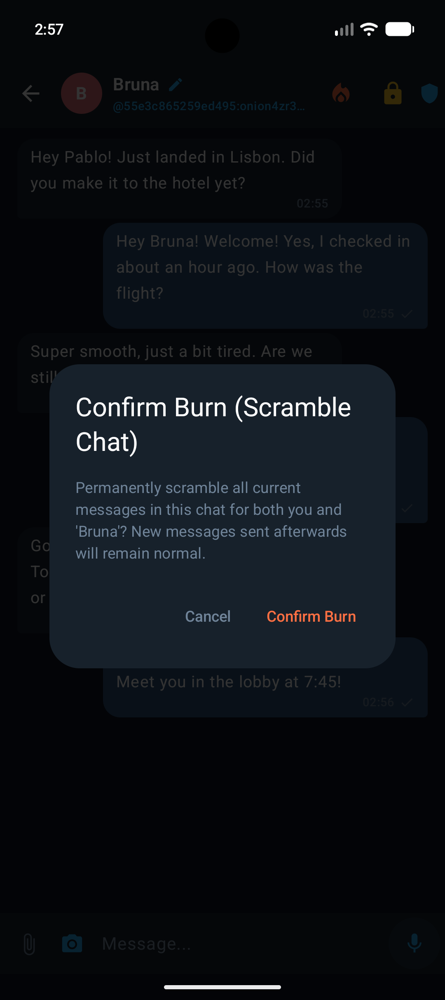 | 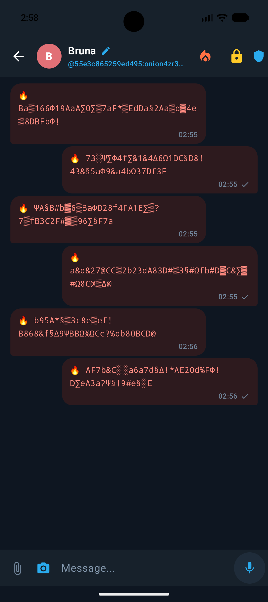 |

#### What It Does & How It Works:
1. **Triggering the Burn**: When Pablo taps the orange flame icon (`🔥`) in the top bar and confirms **Confirm Burn**, two actions occur simultaneously:
   - **Local B-Tree Cell Overwrite**: Every message in the conversation is overwritten in-place inside the local SQLCipher database with high-entropy cryptographic noise (`🔥 Ba▒166Φ19AaA∑0∑...`) before running `PRAGMA secure_delete=ON` and `VACUUM`. This ensures that forensic carving of raw NAND flash memory cannot recover the previous plaintext or ciphertext lengths.
   - **Remote Encrypted Burn Signal (`[CMD:BURN_CHAT]`)**: An authenticated E2EE command packet is dispatched across the `.onion` mesh to Bruna's device. As soon as Bruna's client pulls the packet, her local database executes the exact same B-Tree cell overwrite and `VACUUM`, scrubbing both sides of the conversation in sync.
2. **Continued Conversation**: Any new messages sent *after* the burn remain normal until the next burn is triggered.

---

### 4. Local Cryptographic Identity, EXIF Stripper & QR Code

In **Settings → Profile**, users manage their local identity, sanitize profile avatars, and share their `.onion` address via QR code.

| **4A. Language & Zero-EXIF Avatar Sanitizer** | **4B. `.onion` Cryptographic ID & QR Code** |
| :---: | :---: |
| 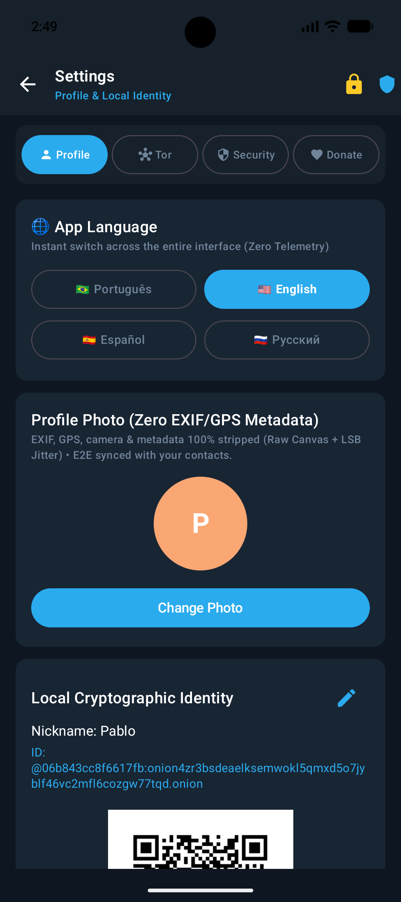 | 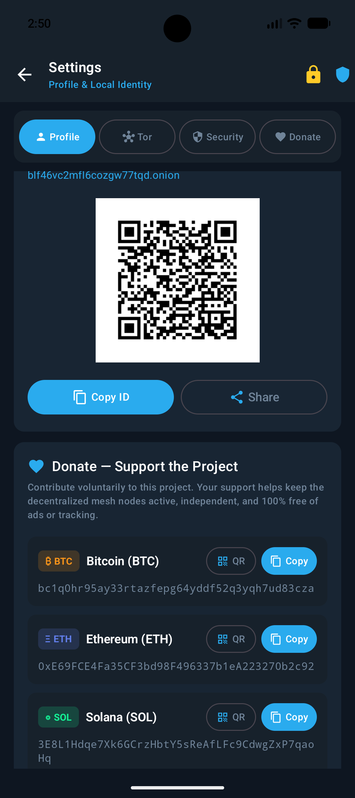 |

#### What It Does & How It Works:
- **Zero-EXIF / Raw Canvas + LSB Jitter Sanitizer**: Smartphone photos embed dangerous metadata (GPS coordinates, camera serial numbers, timestamps, and sensor noise fingerprints). When you select a profile photo or image attachment in OnionTalk, the app decodes the raw pixels onto a clean bitmap canvas—stripping 100% of EXIF/GPS headers—and applies subtle Least Significant Bit (`LSB`) random jitter to defeat camera sensor fingerprinting before encrypting the image for your contacts.
- **Offline QR Code Generation**: The QR code is rendered locally on the device from your `@pubkey_hash:relay.onion` string so contacts can scan it in person without typing a 56-character `.onion` domain.

---

### 5. Federated `.onion` Mesh Gossip & Tor SOCKS5h Proxy

In **Settings → Tor**, users can inspect the live federated relay mesh discovered via autonomous gossip (`Auto-Gossip PEX`) and customize their SOCKS5h proxy routing.

<div align="center">
  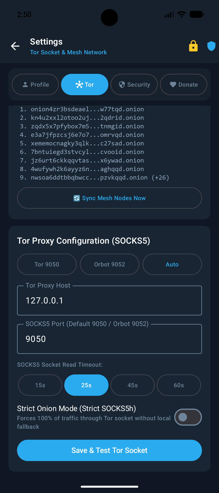
</div>

#### What It Does & How It Works:
- **Autonomous Mesh Discovery (`Sync Mesh Nodes Now`)**: Displays all verified `.onion` v3 relays currently active in the mesh (9 nodes shown above). When sending a message, the client fans out the encrypted envelope to multiple relays simultaneously (`3x` fanout) so messages arrive even if a node goes offline.
- **SOCKS5h Proxy Control (`Tor 9050` / `Orbot 9052` / `Auto`)**: Supports both the embedded Tor daemon (`127.0.0.1:9050`) and external Orbot circuits (`9052`), with configurable socket read timeouts (`15s`–`60s`) for high-latency hidden service hops.
- **Strict Onion Mode (`Strict SOCKS5h`)**: Forces 100% of network traffic through the Tor SOCKS5h socket with remote hostname resolution, blocking any local fallback or clearnet DNS packet.

---

### 6. SQLCipher AES-256 Audit, Screen Protection & Project Support

In **Settings → Security** and **Settings → Donate**, users control physical device hardening, anti-forensic SQLite maintenance, and voluntary project funding.

| **6A. Security, `FLAG_SECURE` & SQLCipher Audit** | **6B. Voluntary Crypto Support (`Donate`)** |
| :---: | :---: |
| 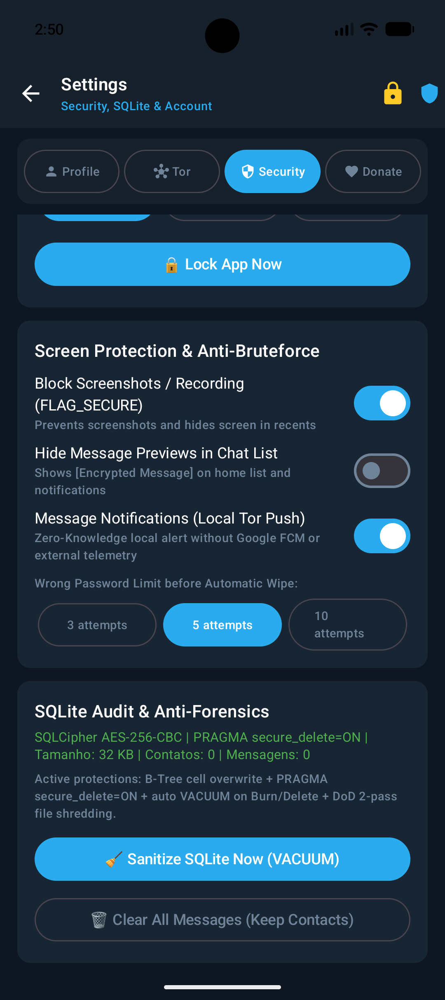 | 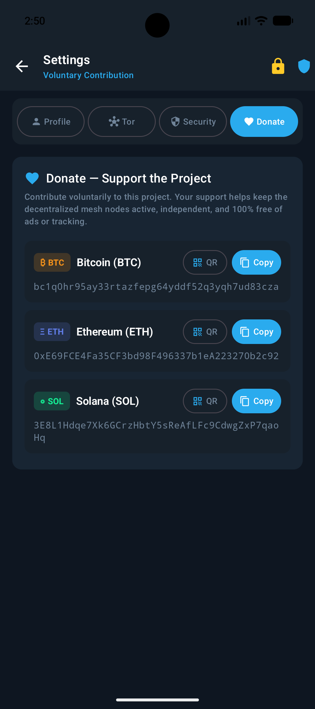 |

#### What It Does & How It Works:
- **Block Screenshots / Recording (`FLAG_SECURE`)**: Enabled by default to prevent screen-capture malware from recording your chats and to blank out the app preview in Android's Recent Apps switcher. *(Note: The screenshots in this walkthrough were captured directly from the host GPU framebuffer on our development emulators).*
- **Hide Message Previews in Chat List**: Replaces conversation snippets on the home screen with `[Encrypted Message]` for shoulder-surfing protection in public spaces.
- **Zero-FCM Local Tor Push Notifications**: Unlike conventional messengers that wake your device via Google Firebase Cloud Messaging (leaking metadata to Google servers every time a message arrives), OnionTalk polls the `.onion` mesh directly over a persistent background Tor circuit.
- **Real-Time SQLCipher Audit & Manual `VACUUM`**: Displays live database encryption metrics (`SQLCipher AES-256-CBC | PRAGMA secure_delete=ON`) and lets you trigger an immediate `VACUUM` sanitization or wipe all message history while preserving your contact list.

---

## 📲 How to Install from Google Play

1. Open [**OnionTalk – Apps no Google Play**](https://play.google.com/store/apps/details?id=org.oniontalk.messenger) on your Android device (Android 8.0+ / API 26+) and tap **Install**.
2. Select your preferred language (`🇺🇸 EN`, `🇧🇷 PT`, `🇪🇸 ES`, `🇷🇺 RU`), tap **Create New Cryptographic Identity**, choose a local nickname and master password, and wait ~10 seconds for the top bar to show **`Connected via Tor`**.
3. **Ao baixar, entre em contato com um de nossos administradores pelo app:**
   ```text
   @bbac48f99ed4536ce9134df16cc49dbed2d9109ed351710d181d86c28f34efd9:onion4zr3bsdeaelksemwokl5qmxd5o7jyblf46vc2mfl6cozgw77tqd.onion
   ```
   - 📸 **Instagram Oficial:** [https://www.instagram.com/oniontalk.app/](https://www.instagram.com/oniontalk.app/) (`@oniontalk.app`)

---

## 💖 Sponsor & Donate

OnionTalk is funded entirely by voluntary community contributions—zero ads, zero tracking, and zero venture capital. Your support keeps our Tor v3 seed relays online across multiple regions.

- **Sponsorship & Donations**: [**Direct Crypto Sponsorship (`BTC` / `ETH` / `SOL`)**](#-sponsor--donate)
- **Bitcoin (`BTC`)**: `bc1q0hr95ay33rtazfepg64yddf52q3yqh7ud83cza`
- **Ethereum (`ETH`)**: `0xE69FCE4Fa35CF3bd98F496337b1eA223270b2c92`
- **Solana (`SOL`)**: `3E8L1Hdqe7Xk6GCrzHbtY5sReAfLFc9CdwgZxP7qaoHq`
- **💬 Em caso de doação por algum outro meio / Contato do Administrador pelo App**:
  ```text
  @bbac48f99ed4536ce9134df16cc49dbed2d9109ed351710d181d86c28f34efd9:onion4zr3bsdeaelksemwokl5qmxd5o7jyblf46vc2mfl6cozgw77tqd.onion
  ```
- **📸 Instagram Oficial**: [https://www.instagram.com/oniontalk.app/](https://www.instagram.com/oniontalk.app/) (`@oniontalk.app`)

---

## 📄 License

Distributed under the [MIT License](./LICENSE).

---

## ⚠️ Legal Disclaimers, Limitation of Liability & Sovereign Terms of Use (`v1.5.0`)

1. **"AS IS" Open-Source Provision & Cryptographic Research Purpose**: OnionTalk (`org.oniontalk.messenger`), OnionTalk Relay Node (`org.oniontalk.relaynode`), and the Desktop/Web Container (`oniontalk-web`) are distributed strictly **"AS IS"**, without warranties of any kind under the MIT License, as cryptographic engineering and digital privacy technology (`Privacy by Design`).
2. **Irreversible Zero-Knowledge Custody (No Password Recovery)**: Because OnionTalk operates without central servers, user accounts, emails, or phone numbers, **the developers cannot recover forgotten vault passwords, restore lost private keys, or reverse the 5-Strike Anti-Coercion Wipe (`DoD 5220.22-M`) or Synchronized Bilateral Burn (`🔥`)**. Users are solely responsible for safeguarding their local credentials and backups.
3. **Blind Common-Carrier Relay Safe Harbor**: Federated `.onion` v3 relay nodes act strictly as **blind, non-custodial encrypted envelope routers**. Relays possess neither the private `X25519` keys nor the post-quantum `ML-KEM-768` decapsulation keys required to inspect, filter, or modify message contents, and expose only deterministic synthetic topology coordinates (`Zero IP / Zero Cloud Provider Leak`).
4. **Lawful Use & User Responsibility**: Users assume full and exclusive legal responsibility for their use of the software in their respective jurisdictions. Using OnionTalk for unlawful activities is strictly prohibited by the project's terms of use.
5. **Non-Affiliation**: OnionTalk is an independent open-source project and is not affiliated with, endorsed by, or sponsored by *The Tor Project, Inc.*
